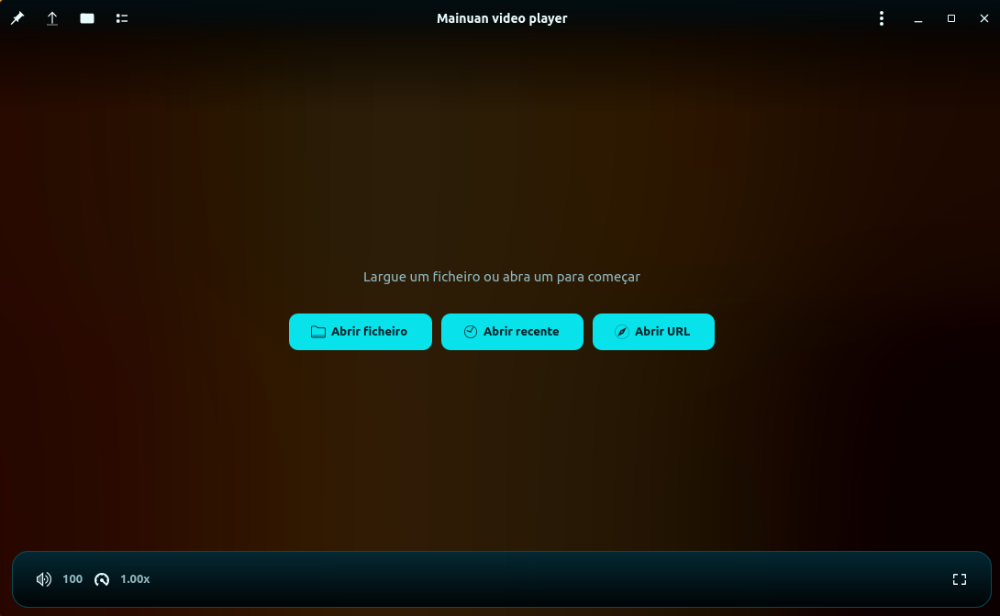
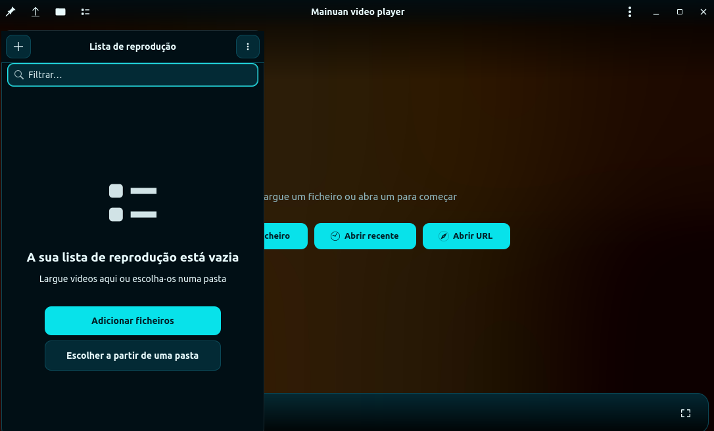
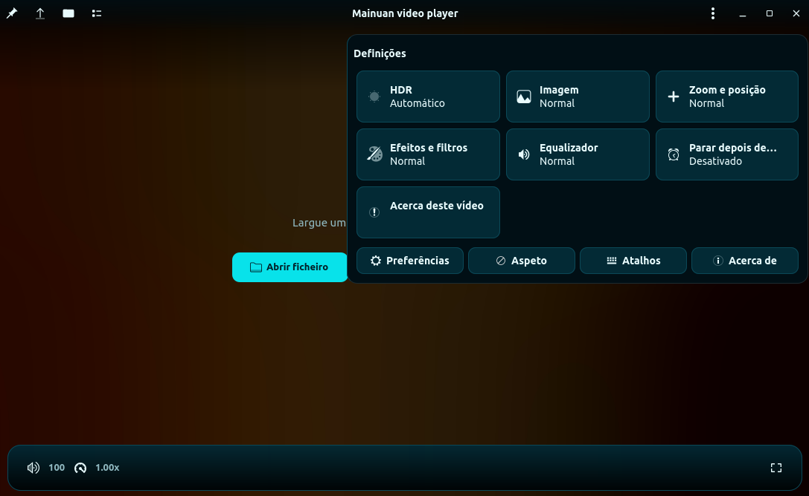

<div align="center">


# MAINUAN VIDEO PLAYER


Leitor de vídeo com **aceleração por hardware** para a distribuição Mainuan, em **GTK4/libadwaita** sobre o **mpv**. Inclui shaders de upscaling (FSR, CAS, Anime4K e RAVU), controlos MPRIS e traduções em muitos idiomas, incluindo português (PT).

</div>

## 📸 Screenshots

<div align="center">
  
  
  
</div>

## ✨ Funcionalidades

- **Aceleração por hardware:** descodificação com VAAPI, VDPAU e NVDEC.
- **Formatos comuns:** MP4, MKV, WebM, MOV, AVI e outros, através do mpv e do ffmpeg.
- **Abrir de várias formas:** ficheiro, vídeos recentes, URL, ou arrastar e largar.
- **Lista de reprodução:** adicionar ficheiros ou pastas, com filtro de pesquisa.
- **Shaders de upscaling:** FSR, CAS, Anime4K e RAVU.
- **Definições de vídeo e áudio:** HDR, imagem, zoom e posição, efeitos e filtros, equalizador e temporizador para parar a reprodução.
- **Legendas:** suporte a faixas de legendas.
- **MPRIS:** controlo pelas teclas multimédia e pelo ambiente de trabalho.
- **Preferências, aspeto e atalhos** configuráveis.
- **Visual Mainuan:** cores, formas e tipo de letra iguais ao Mainuan audio player.
- **Multilingue:** mais de 30 idiomas, incluindo português (PT) e português (BR).

## 📋 Requisitos

- Linux **amd64** com GTK 4.22 ou superior e libadwaita 1.9 ou superior
- `mpv`, `libmpv2` e `ffmpeg`
- PulseAudio ou PipeWire (compatível com PulseAudio)

As dependências são instaladas automaticamente pelo `apt` ao instalar o `.deb`.

## 📦 Instalação

Descarrega o ficheiro `.deb` mais recente na página de [Releases](../../releases) e instala:

```bash
sudo apt install ./mainuan-video-player_1.0.1.deb
```

Depois abre **Mainuan video player** no menu de aplicações, ou executa no terminal:

```bash
mainuan-video-player
```

> **Nota:** ao instalar, se o `mpv` estiver presente, o pacote cria uma cópia do lançador do mpv em `/usr/local/share/applications/` com o ícone Mainuan. Os ficheiros do próprio mpv não são alterados.

## 🔧 Compilar o pacote a partir do código

```bash
git clone https://github.com/tugatechlabDC/mainuan-video-player.git
cd mainuan-video-player
dpkg-deb --root-owner-group --build package mainuan-video-player_1.0.1.deb
```

## 📁 Estrutura do projeto

```text
mainuan-video-player/
├── package/
│   ├── DEBIAN/                          # control, md5sums, postinst, postrm
│   └── usr/
│       ├── bin/                         # lançador (mainuan-video-player)
│       ├── lib/mainuan-video-player/    # executável e bibliotecas de tema
│       └── share/                       # .desktop, metainfo, ícones, shaders, traduções
├── assets/screenshots/
├── CHANGELOG.md
├── LICENSE
└── README.md
```

## 🆕 Novidade da versão 1.0.1

Publicação do projeto no GitHub, com README, CHANGELOG, licença e screenshots. Vê o [CHANGELOG](CHANGELOG.md) para o histórico completo.

## 🙏 Créditos

- Construído sobre o [mpv](https://mpv.io) e o ffmpeg.
- Shaders de upscaling FSR e CAS (AMD), Anime4K e RAVU, distribuídos sob licença MIT. Os avisos de direitos de autor estão em `package/usr/share/doc/mainuan-video-player/MIT-shaders`.

Versão com a marca Mainuan do leitor de áudio **big-video-player**, trabalho original da **BigLinux**
O aviso de direitos de autor original é mantido, conforme exige a GPL.

## 📄 Licença

Distribuído sob a licença **GPL-3.0 ou posterior**. Vê o ficheiro [LICENSE](LICENSE). Alguns componentes são LGPL-3+ e os shaders são MIT, como indicado no ficheiro `copyright` do pacote.

## 👤 Autor

**David Caixinha** — tugatechlabDC (adaptação Mainuan)

## 🤝 Contribuição

Para reportar erros ou pedir funcionalidades, abre um [Issue](https://github.com/mainuan/mainuan-video-player/issues). Para propor alterações, envia um pull request para o ramo `main` e regista qualquer alteração visível no [CHANGELOG.md](CHANGELOG.md).
